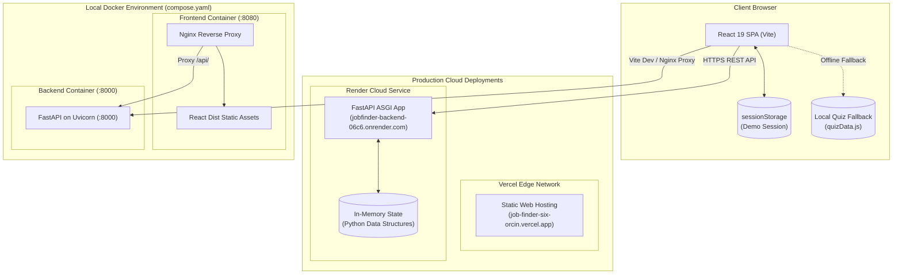
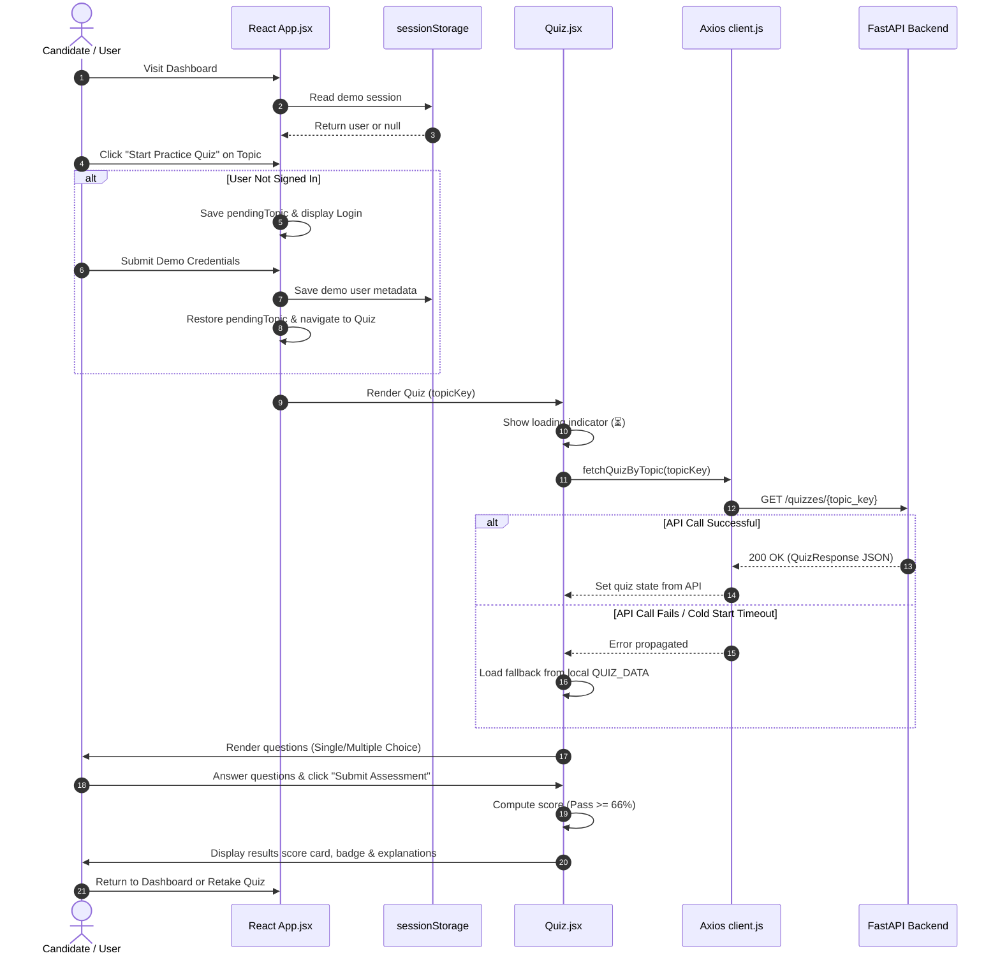
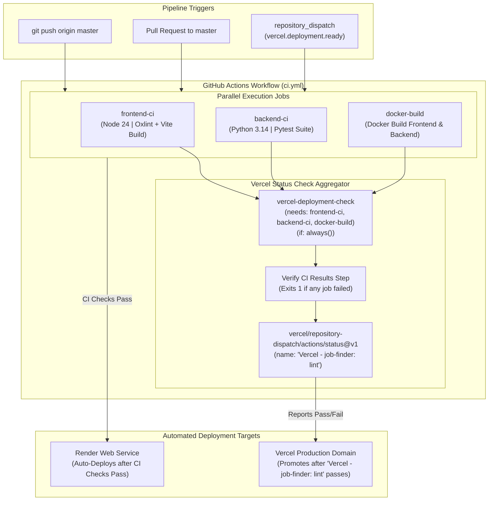

# JobFinder

> **Interactive Full-Stack Technical Preparation Platform for Software Engineering Candidates**

[](https://github.com/umeshchakor30/JobFinder/actions/workflows/ci.yml)
[](https://job-finder-six-orcin.vercel.app)
[](https://jobfinder-backend-06c6.onrender.com)
[](https://fastapi.tiangolo.com)
[](https://react.dev)
[](https://www.docker.com)

---

## Table of Contents

1. [Project Title and Overview](#1-project-title-and-overview)
2. [Project Objectives](#2-project-objectives)
3. [Key Features](#3-key-features)
4. [Technology Stack](#4-technology-stack)
5. [System Architecture](#5-system-architecture)
6. [Application Workflow](#6-application-workflow)
7. [Project Directory Structure](#7-project-directory-structure)
8. [Frontend Architecture](#8-frontend-architecture)
9. [Backend Architecture](#9-backend-architecture)
10. [API Documentation](#10-api-documentation)
11. [Quiz System and Scoring](#11-quiz-system-and-scoring)
12. [Docker Architecture](#12-docker-architecture)
13. [Docker Compose Setup](#13-docker-compose-setup)
14. [Nginx Reverse Proxy](#14-nginx-reverse-proxy)
15. [CI/CD Architecture](#15-cicd-architecture)
16. [GitHub Actions Workflow](#16-github-actions-workflow)
17. [Vercel Frontend Deployment](#17-vercel-frontend-deployment)
18. [Render Backend Deployment](#18-render-backend-deployment)
19. [Environment Variables](#19-environment-variables)
20. [Local Development Setup](#20-local-development-setup)
21. [Running Tests and Quality Checks](#21-running-tests-and-quality-checks)
22. [Production URLs](#22-production-urls)
23. [Known Limitations](#23-known-limitations)
24. [Future Improvements](#24-future-improvements)

---

## 1. Project Title and Overview

**JobFinder** is an interactive, full-stack practice platform built to help software engineering candidates evaluate, prepare, and sharpen their technical skills across modern full-stack and DevOps competencies.

The application combines a high-performance **React 19** frontend powered by **Vite** with an asynchronous **FastAPI** backend in **Python 3.12+**. The platform offers practice assessments across six core software engineering tracks: **React.js**, **Python / FastAPI**, **Git**, **Docker**, **CI / CD**, and **Vercel**.

To emulate a production-grade engineering workflow, the repository is containerized with **Docker** and **Docker Compose**, features an **Nginx** reverse proxy, and enforces an automated **GitHub Actions** CI/CD pipeline integrated directly with **Vercel Deployment Checks** and **Render Auto-Deploy**.

---

## 2. Project Objectives

- **Targeted Technical Preparation**: Provide software engineering candidates with hands-on practice assessments focused on real-world concepts, tooling, and best practices.
- **Resilient Full-Stack Architecture**: Implement a decoupled architecture where the frontend dynamically queries backend REST APIs while maintaining client-side offline fallback capabilities when network access or server instances are cold.
- **Containerized Parity**: Guarantee environment consistency between local development and production deployments using multi-stage Docker builds and Docker Compose service orchestration.
- **Automated Delivery Pipeline**: Enforce automated linting, test suites, container builds, and deployment verification checks via GitHub Actions before code is promoted to live production environments.

---

## 3. Key Features

- **Six Technical Assessment Tracks**: Curated multiple-choice assessments spanning 18 questions across Frontend, Backend, Version Control, Containerization, Automation, and Cloud Hosting.
- **Dynamic API Delivery with Offline Fallback**: Quizzes are retrieved dynamically from FastAPI (`GET /quizzes/{topic_key}`). If the backend is undergoing a cold start or is temporarily unreachable, the frontend seamlessly falls back to local question data without crashing or disrupting the user.
- **Interactive Quiz Interface**: Supports single-choice and multiple-choice questions, real-time question progress, answer selection review, dynamic scoring, pass/fail status determination, and explanatory rationale.
- **Client-Side Demo Session**: Lightweight demo sign-in and registration flow persisted in browser `sessionStorage`, allowing candidates to test authentication-gated quiz interactions without exposing personal credentials.
- **FastAPI REST API**: Self-documenting API with interactive Swagger UI (`/docs`), ReDoc (`/redoc`), and automatic Pydantic request/response validation.
- **Job Applications API Endpoints**: Full in-memory CRUD operations (`GET`, `POST`, `PUT`, `PATCH`, `DELETE`) with query pagination and status filtering for backend demonstration and testing.
- **Zero-CORS Multi-Container Setup**: Configured with Nginx reverse proxy routing API requests under `/api/` directly to FastAPI when running inside Docker containers.

---

## 4. Technology Stack

### Frontend
| Component | Technology | Version | Purpose |
| :--- | :--- | :--- | :--- |
| **Framework** | React | `^19.3.1` | Component-driven UI library |
| **Build Tool** | Vite | `^8.3.5` | Fast build tool and dev server |
| **HTTP Client** | Axios | `^1.21.0` | Centralized REST client with baseURL switching |
| **Linter** | Oxlint | `^1.89.0` | High-speed JavaScript/JSX static analysis |
| **Styling** | Native CSS3 | Modern CSS | CSS Variables, responsive grid, flexbox layout |

### Backend
| Component | Technology | Version | Purpose |
| :--- | :--- | :--- | :--- |
| **Framework** | FastAPI | `0.162.0` | Asynchronous web framework for REST APIs |
| **ASGI Server** | Uvicorn | `0.54.0` | Production ASGI web server |
| **Data Validation** | Pydantic v2 | Bundled | Strict request/response schema modeling |
| **Testing** | Pytest | Latest | Automated unit and integration testing |
| **Test Client** | HTTPX | Latest | Non-blocking test client for FastAPI routes |

### DevOps & Deployment
| Layer | Technology | Details |
| :--- | :--- | :--- |
| **Container Engine** | Docker | Multi-stage builder for frontend, slim runtime for backend |
| **Orchestration** | Docker Compose | Local multi-container networking (`compose.yaml`) |
| **Reverse Proxy** | Nginx Alpine | Serves static assets & proxies `/api/` to backend |
| **CI Automation** | GitHub Actions | 4-job pipeline (`.github/workflows/ci.yml`) |
| **Frontend Cloud** | Vercel | Production static hosting with deployment check gates |
| **Backend Cloud** | Render | Production containerized Web Service with health check |

---

## 5. System Architecture

The JobFinder system is designed with a decoupled architecture. The React single-page application (SPA) communicates with the FastAPI backend over HTTP/HTTPS REST endpoints.



### Architectural Principles
1. **Decoupled Client & Server**: The frontend and backend run as independent applications and communicate strictly via standardized JSON REST interfaces.
2. **Graceful Degradation**: If the backend service is spinning up or offline, the React client automatically detects the API failure and utilizes local track datasets.
3. **Environment Agnostic Configuration**: The frontend determines API base URLs dynamically using Vite environment variables (`VITE_API_URL`) or falls back to production defaults when built in production mode.
4. **CORS Governance**: FastAPI dynamically parses permitted origins from the `FRONTEND_URL` environment variable, avoiding wildcard (`*`) credentials vulnerabilities.

---

## 6. Application Workflow

The diagram below illustrates the end-to-end user and data flow when interacting with technical quizzes:



---

## 7. Project Directory Structure

```text
JobFinder/
│
├── .github/
│   └── workflows/
│       └── ci.yml                 # GitHub Actions 4-job CI/CD workflow
│
├── backend/
│   ├── tests/
│   │   ├── __init__.py
│   │   └── test_main.py           # Pytest test suite for health, quiz & CORS
│   ├── .dockerignore              # Docker ignore rules for backend
│   ├── Dockerfile                 # Python 3.12-slim container definition
│   ├── main.py                    # FastAPI app, endpoints, schemas & middleware
│   ├── quiz_data.py               # Static Python dictionary for the 6 quiz tracks
│   └── requirements.txt           # Python package dependencies
│
├── frontend/
│   ├── public/                    # Static assets & icons
│   ├── src/
│   │   ├── api/
│   │   │   ├── applications.js    # Axios service for applications CRUD API
│   │   │   ├── client.js          # Centralized Axios HTTP client instance
│   │   │   └── quiz.js            # Axios service for quiz track API calls
│   │   ├── assets/                # Logos and vector icons
│   │   ├── components/
│   │   │   ├── ApplicationsTracker.css
│   │   │   ├── ApplicationsTracker.jsx # Demo applications tracker component
│   │   │   ├── Login.jsx          # Client-side demo sign-in form
│   │   │   ├── Quiz.jsx           # Interactive quiz runner, scoring & fallback
│   │   │   └── Register.jsx       # Client-side demo registration form
│   │   ├── data/
│   │   │   └── quizData.js        # Local JavaScript quiz dataset (fallback)
│   │   ├── App.css                # Global dashboard styling & design system
│   │   ├── App.jsx                # Main application layout, state & routing
│   │   ├── index.css              # Reset rules and CSS custom properties
│   │   └── main.jsx               # React DOM entry point
│   ├── .dockerignore              # Docker ignore rules for frontend
│   ├── .env.development           # Local development environment configuration
│   ├── .oxlintrc.json             # Oxlint rule configuration
│   ├── Dockerfile                 # Multi-stage build (Node 24 -> Nginx Alpine)
│   ├── index.html                 # Single page application HTML shell
│   ├── nginx.conf                 # Nginx server block & /api/ reverse proxy
│   ├── package.json               # NPM scripts and dependencies
│   ├── package-lock.json          # Deterministic dependency tree
│   └── vite.config.js             # Vite build & React plugin configuration
│
├── .gitignore                     # Git repository exclusion rules
├── compose.yaml                   # Multi-service Docker Compose configuration
└── README.md                      # Comprehensive project documentation
```

---

## 8. Frontend Architecture

### Component Hierarchy
```text
main.jsx (DOM Mount)
 └── App.jsx (Navigation, Global State & View Router)
      ├── Header (Brand, Navigation Links, Demo Session Pill / Auth Buttons)
      ├── View: Dashboard (Welcome Banner, Core Track Cards, Skill Tags)
      ├── View: Login (Client-Side Demo Sign-In Form)
      ├── View: Register (Client-Side Demo Registration Form)
      ├── View: Quiz (Asynchronous Loader, Question View, Scorecard & Review)
      └── Footer (Platform Metadata)
```

### State Management & Lifecycle
- **View Navigation**: Managed through React `useState('dashboard' | 'login' | 'register' | 'quiz')`.
- **Demo Session Persistence**: Stored in `sessionStorage` under `jobfinder_demo_session`. The session is restored automatically on page reload and contains only non-sensitive identifiers (`name`, `email`, `isDemo: true`).
- **Guarded Navigation**: Attempting to launch a quiz without an active session preserves the desired track in `pendingQuizTopic`, routes the user to `login`, and automatically redirects into the quiz upon successful demo sign-in.
- **Race Condition Prevention**: In `Quiz.jsx`, the `useEffect` hook utilizes an `ignore` flag boolean to prevent state updates if the user switches topics before an asynchronous request completes.

### Centralized Axios Client (`frontend/src/api/client.js`)
All HTTP communication passes through a single configured Axios instance:
```javascript
const defaultURL = import.meta.env.PROD
  ? 'https://jobfinder-backend-06c6.onrender.com'
  : 'http://127.0.0.1:8000'

const rawBaseURL = import.meta.env.VITE_API_URL || defaultURL

const apiClient = axios.create({
  baseURL: rawBaseURL.replace(/\/+$/, ''),
  headers: {
    'Content-Type': 'application/json'
  }
})
```
- In development, requests default to `http://127.0.0.1:8000`.
- In production builds (`import.meta.env.PROD`), requests route to the live Render backend.
- Custom deployments can override the target URL via `VITE_API_URL`.

---

## 9. Backend Architecture

### FastAPI Application (`backend/main.py`)
The backend is structured around FastAPI's asynchronous ASGI architecture:
1. **Dynamic CORS Middleware**:
   ```python
   allowed_origins = [
       "http://localhost:5173",
       "http://127.0.0.1:5173"
   ]
   frontend_url = os.getenv("FRONTEND_URL")
   if frontend_url and frontend_url.strip():
       for origin in frontend_url.split(","):
           clean_origin = origin.strip().rstrip("/")
           if clean_origin and clean_origin not in allowed_origins:
               allowed_origins.append(clean_origin)
   ```
2. **Safe Request Logging Middleware**:
   Logs HTTP method, path, response status, and duration in milliseconds without recording authorization headers or payload bodies.
3. **Pydantic Validation**:
   Enforces strict type checking, string length constraints (`min_length=2`), and automatic JSON schema serialization.
4. **Dependency Injection**:
   Utilizes FastAPI's `Depends(pagination_params)` to validate `page` (minimum `1`) and `limit` query parameters across collection endpoints.
5. **In-Memory Storage**:
   Applications and quiz datasets are managed via Python in-memory data structures. **Data resets to default fixtures whenever the backend process restarts.**

---

## 10. API Documentation

### Interactive API Explorers
When running locally or on Render, FastAPI provides automated documentation interfaces:
- **Swagger UI**: `/docs`
- **ReDoc**: `/redoc`
- **OpenAPI JSON**: `/openapi.json`

### Endpoints Summary

| Method | Endpoint | Description | Request Body | Response Model / Status |
| :--- | :--- | :--- | :--- | :--- |
| `GET` | `/health` | Service health status | None | `200 OK` (JSON) |
| `GET` | `/stats` | Application metric counts | None | `200 OK` (JSON) |
| `GET` | `/quizzes/{topic_key}` | Retrieve questions for a topic track | None | `QuizResponse` (`200 OK`) or `404` |
| `GET` | `/applications` | Paginated list of applications | None | `list[ApplicationResponse]` (`200 OK`) |
| `GET` | `/applications/{id}` | Single application record by ID | None | `ApplicationResponse` (`200 OK`) or `404` |
| `POST` | `/applications` | Create new application | `ApplicationCreate` | `ApplicationResponse` (`201 Created`) |
| `PUT` | `/applications/{id}` | Replace entire application | `ApplicationReplace` | `ApplicationResponse` (`200 OK`) or `404` |
| `PATCH` | `/applications/{id}` | Partially update application fields | `ApplicationUpdate` | `ApplicationResponse` (`200 OK`) or `400/404` |
| `DELETE`| `/applications/{id}` | Delete application by ID | None | `200 OK` (JSON with deleted object) |

### Key API Schemas

#### `GET /quizzes/{topic_key}`
**Path Parameters**:
- `topic_key` (`string`): One of `react`, `fastapi`, `git`, `docker`, `cicd`, `vercel`.

**Sample Response (`200 OK`)**:
```json
{
  "title": "React.js",
  "icon": "⚛️",
  "description": "Test your understanding of React components, hooks, state, and Vite.",
  "questions": [
    {
      "id": "react-1",
      "type": "single",
      "question": "Which built-in hook is used to declare and update local state in a functional component?",
      "options": ["useEffect", "useState", "useContext", "useReducer"],
      "correct": [1],
      "explanation": "useState is the primary hook for adding local state variables to functional components."
    }
  ]
}
```

**Sample Error Response (`404 Not Found`)**:
```json
{
  "detail": "Quiz topic 'unknown' not found. Available topics: react, fastapi, git, docker, cicd, vercel"
}
```

---

## 11. Quiz System and Scoring

### Practice Tracks

| Topic Key | Track Title | Category | Icon | Competencies Evaluated |
| :--- | :--- | :--- | :---: | :--- |
| `react` | **React.js** | Frontend | ⚛️ | Components, Props, `useState`, `useEffect`, Virtual DOM |
| `fastapi` | **Python / FastAPI** | Backend | ⚡ | Async handlers, Pydantic models, Dependency Injection |
| `git` | **Git** | Version Control | 🌿 | Commit hygiene, merge vs rebase, staging, branching |
| `docker` | **Docker** | DevOps | 🐳 | Multi-stage Dockerfiles, Compose networking, caching |
| `cicd` | **CI / CD** | Automation | 🔄 | GitHub Actions workflows, automated testing, checks |
| `vercel` | **Vercel** | Cloud Hosting | ▲ | Preview deployments, deployment checks, environment configs |

### Question Formats
1. **Single Choice (`type: "single"`)**:
   - Radio-style selection where choosing an option replaces the current selection.
2. **Multiple Choice (`type: "multiple"`)**:
   - Checkbox-style selection where options toggle independently. Prompt explicitly notifies candidates: `(Select all that apply)`.

### Scoring Algorithm
- **Exact Match Evaluation**: A question is scored as correct if and only if the candidate's selected options match the question's `correct` index list in both length and value:
  $$\text{isCorrect} = (\text{length}(\text{userChoices}) == \text{length}(\text{correct})) \land (\forall c \in \text{correct}, c \in \text{userChoices})$$
- **Percentage Score**:
  $$\text{Percentage} = \text{round}\left(\frac{\text{Correct Count}}{\text{Total Questions}} \times 100\right)$$
- **Passing Threshold**: A score of **$\ge 66\%$** (2 out of 3 questions correct) awards a `Passed` badge; scores below $66\%$ receive a `Needs Review` indicator with full answer explanations.

---

## 12. Docker Architecture

### Backend Container (`backend/Dockerfile`)
Built on top of the lightweight `python:3.12-slim` image:
```dockerfile
FROM python:3.12-slim
WORKDIR /app
COPY requirements.txt .
RUN pip install --no-cache-dir -r requirements.txt
COPY . .
EXPOSE 8000
CMD ["uvicorn", "main:app", "--host", "0.0.0.0", "--port", "8000"]
```
- **Layer Optimization**: Copies and installs `requirements.txt` before copying application source code to take advantage of Docker build layer caching.
- **Slim Footprint**: Omits unnecessary build tools, keeping image sizes small and attack surfaces minimal.

### Frontend Container (`frontend/Dockerfile`)
Implements a multi-stage Docker build:
```dockerfile
# Stage 1: Build React static bundle
FROM node:24-alpine AS builder
WORKDIR /app
COPY package*.json ./
RUN npm install
COPY . .
RUN npm run build

# Stage 2: Serve via Nginx
FROM nginx:alpine
RUN rm -rf /usr/share/nginx/html/*
COPY --from=builder /app/dist /usr/share/nginx/html
COPY nginx.conf /etc/nginx/conf.d/default.conf
EXPOSE 80
CMD ["nginx", "-g", "daemon off;"]
```
- **Builder Stage**: Compiles modern JSX into static HTML/CSS/JS artifacts using Node 24.
- **Production Stage**: Copies only the resulting `dist/` directory into a secure Nginx Alpine container, leaving Node.js and `node_modules` out of the final runtime image.

---

## 13. Docker Compose Setup

The root [`compose.yaml`](file:///d:/mearn/JobFinder/compose.yaml) file defines the multi-container configuration for running JobFinder locally:

```yaml
services:
  backend:
    build:
      context: ./backend
    ports:
      - "8000:8000"

  frontend:
    build:
      context: ./frontend
    ports:
      - "8080:80"
    depends_on:
      - backend
```

### Docker Compose Commands

**Build and start services**:
```powershell
docker compose up --build -d
```

**View running containers**:
```powershell
docker compose ps
```

**Inspect application logs**:
```powershell
docker compose logs -f
```

**Stop and clean up containers**:
```powershell
docker compose down
```

When started with Docker Compose:
- The React application is accessible at: `http://localhost:8080`
- The FastAPI backend is accessible at: `http://localhost:8000`
- Nginx proxies internal calls from `http://localhost:8080/api/` directly to `http://backend:8000/`.

---

## 14. Nginx Reverse Proxy

The frontend container runs Nginx configured via [`frontend/nginx.conf`](file:///d:/mearn/JobFinder/frontend/nginx.conf):

```nginx
server {
    listen 80;
    server_name localhost;

    # 1. Serve React single page application
    location / {
        root /usr/share/nginx/html;
        index index.html;
        try_files $uri $uri/ /index.html;
    }

    # 2. Forward API requests to FastAPI
    location /api/ {
        proxy_pass http://backend:8000/;

        proxy_set_header Host $host;
        proxy_set_header X-Real-IP $remote_addr;
        proxy_set_header X-Forwarded-For $proxy_add_x_forwarded_for;
        proxy_set_header X-Forwarded-Proto $scheme;
    }
}
```

### Purpose & Benefits
1. **SPA Routing**: The `try_files $uri $uri/ /index.html;` directive ensures client-side routing works without 404 errors when refreshing direct page paths.
2. **Reverse Proxy & CORS Elimination**: Requests to `/api/*` are internally forwarded to the backend container (`http://backend:8000/`) over the Docker network. The browser treats requests as same-origin, completely eliminating cross-origin issues in containerized production deployments.
3. **Header Propagation**: Standard `X-Forwarded-*` headers pass the original client IP and scheme through to FastAPI.

---

## 15. CI/CD Architecture

The continuous integration and deployment pipeline integrates **GitHub Actions**, **Render**, and **Vercel**:



---

## 16. GitHub Actions Workflow

The automated workflow is configured in [`.github/workflows/ci.yml`](file:///d:/mearn/JobFinder/.github/workflows/ci.yml):

### 1. Triggers
- `push` to `master`
- `pull_request` to `master`
- `workflow_dispatch` (manual trigger)
- `repository_dispatch` for event type `vercel.deployment.ready`

### 2. Workflow Permissions
Explicitly scoped token permissions:
```yaml
permissions:
  contents: read
  actions: read
  statuses: write
```

### 3. Pipeline Jobs

#### Job 1: `frontend-ci`
- **Runner**: `ubuntu-latest`
- **Environment**: Node.js `24` with `npm` caching.
- **Steps**:
  1. Checks out repository at `${{ github.event.client_payload.git.sha || github.ref }}`.
  2. Installs dependencies via `npm ci`.
  3. Executes `npm run lint` (`oxlint` static code analysis).
  4. Executes `npm run build` (`vite build` production compilation).

#### Job 2: `backend-ci`
- **Runner**: `ubuntu-latest`
- **Environment**: Python `3.14`.
- **Steps**:
  1. Checks out repository.
  2. Upgrades `pip` and installs dependencies from `backend/requirements.txt`.
  3. Executes `python -m pytest -v` (runs test suite including CORS preflight and quiz endpoints).

#### Job 3: `docker-build`
- **Runner**: `ubuntu-latest`
- **Steps**:
  1. Builds backend Docker image: `docker build -t jobfinder-backend:ci ./backend`
  2. Builds frontend Docker image: `docker build -t jobfinder-frontend:ci ./frontend`

#### Job 4: `vercel-deployment-check`
- **Role**: Gatekeeper aggregator job.
- **Condition**: `needs: [frontend-ci, backend-ci, docker-build]` with `if: always()`.
- **Mechanism**:
  - Initializes Vercel status reporting on the exact deployment commit SHA via `vercel/repository-dispatch/actions/status@v1`.
  - Executes a bash evaluation verifying that all three upstream jobs completed with `result == "success"`.
  - If any job failed or was cancelled, the verification step exits with code `1`, causing the status action's post hook to report `failure` back to Vercel.
  - If all three jobs succeeded, the post hook reports `success` back to Vercel under the exact check name: `Vercel - job-finder: lint`.

---

## 17. Vercel Frontend Deployment

- **Hosting Provider**: [Vercel](https://vercel.com)
- **Production URL**: [https://job-finder-six-orcin.vercel.app](https://job-finder-six-orcin.vercel.app)
- **Root Directory**: `frontend/`
- **Framework Preset**: Vite
- **Build Command**: `npm run build`
- **Output Directory**: `dist`
- **Deployment Checks Protection**: Enabled. Vercel pauses production domain promotion until the GitHub Actions check `Vercel - job-finder: lint` reports a successful conclusion.

---

## 18. Render Backend Deployment

- **Hosting Provider**: [Render](https://render.com)
- **Production URL**: [https://jobfinder-backend-06c6.onrender.com](https://jobfinder-backend-06c6.onrender.com)
- **Deployment Type**: Web Service (Docker Runtime)
- **Root Directory**: `backend/`
- **Health Check Path**: `/health`
- **Deployment Trigger**: Configured to auto-deploy **After CI Checks Pass**.

> [!NOTE]
> **Render Free-Tier Cold Starts**: On Render's free tier, backend instances automatically spin down after 15 minutes of inactivity. When a request arrives after being idle, the instance may take **30 to 60 seconds** to spin up.
>
> JobFinder's frontend handles this gracefully: if a quiz request times out during a cold start, the React client automatically falls back to local question data so the candidate can continue practicing uninterrupted.

---

## 19. Environment Variables

### Frontend Environment Variables
Configured in `frontend/.env.development` or in Vercel Project Settings:

| Variable | Environment | Default / Example Value | Description |
| :--- | :--- | :--- | :--- |
| `VITE_API_URL` | Local Dev | `http://127.0.0.1:8000` | Target base URL for the FastAPI backend |
| `VITE_API_URL` | Vercel Prod | `https://jobfinder-backend-06c6.onrender.com` | Production backend API domain |

### Backend Environment Variables
Configured in Render Service Settings or local shell:

| Variable | Environment | Default / Example Value | Description |
| :--- | :--- | :--- | :--- |
| `FRONTEND_URL` | Local Dev | `http://localhost:5173` | Allowed CORS origins (comma-separated) |
| `FRONTEND_URL` | Render Prod | `https://job-finder-six-orcin.vercel.app` | Production frontend domain for CORS whitelist |
| `PORT` | Local / Render | `8000` (Local) / `10000` (Render) | Server port bound by Uvicorn |

---

## 20. Local Development Setup

### Prerequisites
- **Node.js**: Version `20.x` or higher (Node 24 recommended)
- **Python**: Version `3.12.x` or higher
- **Git**: Installed and available in PATH
- **Docker & Docker Compose** (Optional, for containerized run)

---

### Method A: Local Native Execution (Windows PowerShell)

#### 1. Clone the repository
```powershell
git clone https://github.com/umeshchakor30/JobFinder.git
cd JobFinder
```

#### 2. Configure and run the FastAPI Backend
Open a new PowerShell terminal:
```powershell
cd D:\mearn\JobFinder\backend

# Create virtual environment
python -m venv .venv

# Activate virtual environment
.\.venv\Scripts\Activate.ps1

# Upgrade pip and install dependencies
python -m pip install --upgrade pip
pip install -r requirements.txt

# Start Uvicorn development server
uvicorn main:app --host 127.0.0.1 --port 8000 --reload
```
The backend API is now running at `http://127.0.0.1:8000`. Test it by opening `http://127.0.0.1:8000/health`.

#### 3. Configure and run the React Frontend
Open a second PowerShell terminal:
```powershell
cd D:\mearn\JobFinder\frontend

# Install dependencies
npm install

# Start Vite development server
npm run dev
```
The frontend is now running at `http://localhost:5173`. Open this URL in your browser.

---

### Method B: Containerized Execution with Docker Compose

To run the complete full-stack environment with Nginx proxy in a single command:
```powershell
cd D:\mearn\JobFinder
docker compose up --build
```
- Open `http://localhost:8080` in your browser.
- All requests to `http://localhost:8080/api/*` are automatically reverse-proxied to FastAPI.

---

## 21. Running Tests and Quality Checks

### 1. Frontend Linting & Build Verification
```powershell
cd D:\mearn\JobFinder\frontend

# Run fast static analysis with Oxlint
cmd.exe /c "npm run lint"

# Verify production Vite build
cmd.exe /c "npm run build"
```

### 2. Backend Automated Tests (Pytest)
```powershell
cd D:\mearn\JobFinder\backend
.\.venv\Scripts\Activate.ps1

# Run complete test suite with verbose output
python -m pytest -v
```

### 3. Docker Container Build Verification
```powershell
cd D:\mearn\JobFinder

# Test backend image build
docker build -t jobfinder-backend:local ./backend

# Test frontend multi-stage image build
docker build -t jobfinder-frontend:local ./frontend
```

---

## 22. Production URLs

| Resource | Service | URL |
| :--- | :--- | :--- |
| **Live Web Application** | Vercel | [https://job-finder-six-orcin.vercel.app](https://job-finder-six-orcin.vercel.app) |
| **Backend API Service** | Render | [https://jobfinder-backend-06c6.onrender.com](https://jobfinder-backend-06c6.onrender.com) |
| **Health Check Endpoint** | Render | [https://jobfinder-backend-06c6.onrender.com/health](https://jobfinder-backend-06c6.onrender.com/health) |
| **Interactive API Documentation** | Swagger UI | [https://jobfinder-backend-06c6.onrender.com/docs](https://jobfinder-backend-06c6.onrender.com/docs) |
| **Alternative API Documentation** | ReDoc | [https://jobfinder-backend-06c6.onrender.com/redoc](https://jobfinder-backend-06c6.onrender.com/redoc) |
| **OpenAPI Specification** | JSON Schema | [https://jobfinder-backend-06c6.onrender.com/openapi.json](https://jobfinder-backend-06c6.onrender.com/openapi.json) |

---

## 23. Known Limitations

- **In-Memory Volatility**: The backend applications store uses in-memory Python data structures. Any created or modified job applications will reset to default fixture records whenever the backend restarts or re-deploys.
- **Client-Side Demo Authentication**: The sign-in and registration forms operate strictly as a client-side demo flow stored in browser `sessionStorage`. No passwords or credentials are sent to or authenticated by the backend, and no JSON Web Tokens (JWT) are issued.
- **Render Free-Tier Spin Down**: The backend will experience a 30-60 second spin-up latency on initial cold requests after 15 minutes of inactivity.
- **Curated Question Set**: Each of the 6 tracks currently includes 3 curated questions (18 questions total) intended to demonstrate track competency evaluation.

---

## 24. Future Improvements

- **Persistent Database Layer**: Integrate a production relational database (such as PostgreSQL) with SQLAlchemy ORM and Alembic schema migrations.
- **Secure Authentication System**: Implement real backend authentication utilizing Argon2/Bcrypt password hashing, JWT access/refresh token pairs, and HTTP-only cookies.
- **Expanded Question Banks**: Scale quiz coverage to 20+ questions per track, introduce timed mock interview simulations, and randomize question ordering.
- **Candidate Analytics Dashboard**: Persist assessment attempt histories, scoring trends, and strengths/weaknesses breakdown per candidate profile.
- **Applications Tracking Feature Integration**: Connect the client interface with the backend applications CRUD endpoints for persistent tracking of real-world job submissions.
- **Redis Caching**: Introduce a Redis cache layer for high-throughput responses on quiz tracks and global platform statistics.

---

## License & Attribution

Developed as an interactive technical assessment and candidate preparation platform. Built with React, Vite, Python, FastAPI, Docker, and GitHub Actions.
